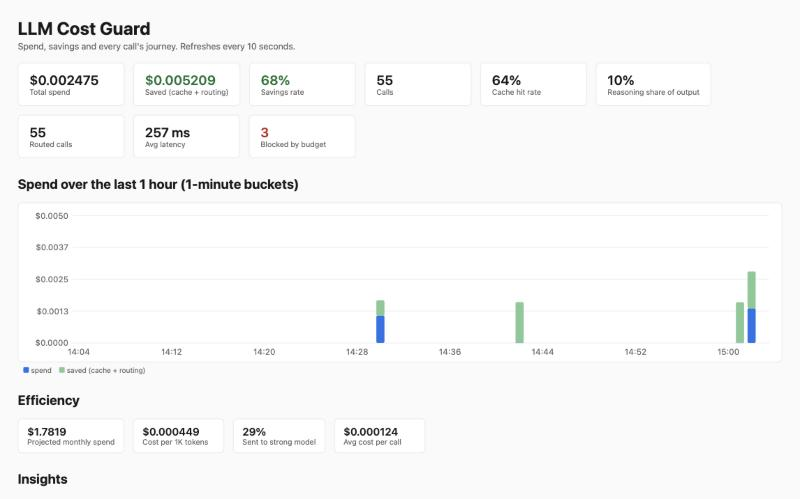
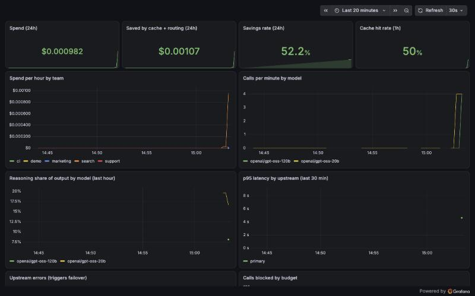
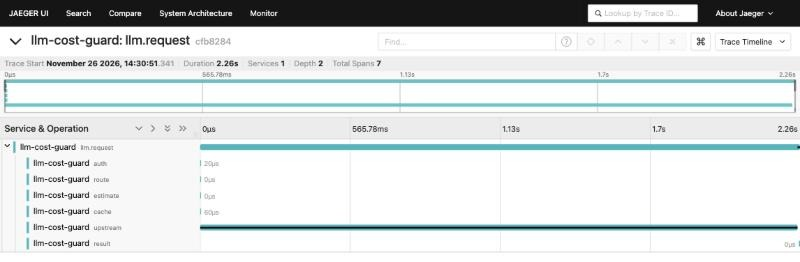

# LLM Cost Guard Platform

[](https://github.com/balakrishnagatla/llm-cost-guard-platform/actions/workflows/ci.yml)
[](https://github.com/balakrishnagatla/llm-cost-guard-platform/actions/workflows/chart.yml)
[](LICENSE)

**Production packaging of [LLM Cost Guard](https://github.com/balakrishnagatla/llm-cost-guard): a Helm chart for Kubernetes, a hardened container image, and reference setups for AWS EKS.**

LLM Cost Guard is a gateway that sits between your apps and LLM providers. It tracks what every call costs by team and feature, and cuts spend with caching, model routing, reasoning control and budgets, with failover and full tracing. The [original repository](https://github.com/balakrishnagatla/llm-cost-guard) is the reference implementation and local Docker Compose prototype. This repository takes it to Kubernetes.

```
                         Kubernetes cluster
  ┌─────────────────────────────────────────────────────────────────┐
  │  Ingress (ALB / NGINX, TLS)                                     │
  │        │                                                        │
  │        ▼                                                        │
  │  Service ──► Deployment: llm-cost-guard  ─────────────────────────────► Groq / OpenAI / Anthropic
  │                 │  non-root, read-only FS, probes                │      (failover to backup provider)
  │                 ├─ ConfigMap: routing.json, pricing.json         │
  │                 ├─ Secret: API keys (External Secrets / Vault)   │
  │                 └─ PersistentVolume: call history, cache         │
  │                                                                 │
  │  /metrics ──► Prometheus (ServiceMonitor) ──► Grafana            │
  │  OTLP     ──► OpenTelemetry Collector ──► Jaeger / Tempo / X-Ray │
  └─────────────────────────────────────────────────────────────────┘
```

## What's here

| Path | What it is |
|---|---|
| `charts/llm-cost-guard/` | Helm chart: Deployment, Service, Ingress, ConfigMap, Secret or existing Secret, PersistentVolumeClaim, ServiceMonitor, Grafana dashboard, NetworkPolicy, PodDisruptionBudget, `helm test`, values schema |
| `deploy/` | Values for a local cluster (with or without monitoring) and for AWS EKS |
| `app/` | The gateway (from LLM Cost Guard v0.5), plus Kubernetes readiness/liveness endpoints and JSON logs |
| `scripts/k8s-local-test.sh` | One-command real-traffic test of the published chart on your laptop |
| `scripts/mock_provider.py` | Simulated LLM provider, used for in-cluster tests and demos |
| `.github/workflows/` | App CI, chart lint and schema validation, end-to-end install on a kind cluster, release to GHCR |

## Test it on your laptop with real traffic

One command creates a kind cluster, installs the published chart from GHCR with Prometheus, Grafana and Jaeger, sends real requests to Groq through the gateway and checks the results:

```bash
git clone https://github.com/balakrishnagatla/llm-cost-guard-platform.git
cd llm-cost-guard-platform
ENV_FILE=~/path/to/.env ./scripts/k8s-local-test.sh   # .env with OPENAI_API_KEY=<your Groq key>
./scripts/k8s-local-test.sh ui     # open the gateway dashboard, Grafana, Prometheus and Jaeger
./scripts/k8s-local-test.sh down   # delete the cluster
```

It checks: `helm test`, routing to the cheap and strong models, cache hits, low reasoning effort, per-call traces, streaming, budgets (429), data surviving a pod restart, JSON logs, Prometheus scraping via the ServiceMonitor, the Grafana dashboard, and traces in Jaeger. Needs Docker Desktop; installs `kind`, `kubectl` and `helm` with Homebrew if missing. Details in the [Kubernetes guide](docs/Kubernetes.md#real-traffic-test-on-a-laptop).

**Latest run (v0.6.6, MacBook Air with Apple Silicon): all 23 checks passed.** 26 real calls cost $0.0011 and the cache and routing saved $0.0021. The runs also found six issues CI couldn't, all now fixed. Results, screenshots and findings: [Real-traffic test](docs/Real-Traffic-Test.md).

| Gateway dashboard | Grafana (shipped with the chart) |
|---|---|
|  |  |



## Quick start on a local cluster

Needs Docker, [kind](https://kind.sigs.k8s.io) (or minikube / Docker Desktop Kubernetes), `kubectl` and `helm`.

```bash
git clone https://github.com/balakrishnagatla/llm-cost-guard-platform.git
cd llm-cost-guard-platform

kind create cluster --name lcg
docker build -t llm-cost-guard-platform:dev .
kind load docker-image llm-cost-guard-platform:dev --name lcg

# Free Groq key from console.groq.com/keys
kubectl create secret generic llm-cost-guard-secrets --from-literal=OPENAI_API_KEY=<your-key>

helm install lcg charts/llm-cost-guard -f deploy/values-local.yaml \
  --set image.repository=llm-cost-guard-platform --set image.tag=dev --set image.pullPolicy=Never
helm test lcg
kubectl port-forward svc/lcg-llm-cost-guard 8080:8080   # dashboard: http://localhost:8080
```

No API key? Add `--set mockProvider.enabled=true --set provider.openaiBaseUrl=http://lcg-llm-cost-guard-mock:9911/primary/v1` to use the built-in simulated provider.

## Install from the registry

Each release publishes the image and the chart to GitHub Container Registry:

```bash
helm install lcg oci://ghcr.io/balakrishnagatla/charts/llm-cost-guard --version 0.6.6 \
  --set secrets.existingSecret=llm-cost-guard-secrets
```

## Production on AWS EKS

`deploy/values-aws-eks.yaml` sets up an internal ALB with TLS, gp3 storage, secrets from AWS Secrets Manager through External Secrets, a Prometheus ServiceMonitor, OpenTelemetry export and network policies. Step by step: [docs/AWS-EKS.md](docs/AWS-EKS.md).

## Security defaults

- Runs as non-root (UID 10001) with a read-only root filesystem, all capabilities dropped and the `RuntimeDefault` seccomp profile
- No service account token mounted
- Secrets come from an existing Secret (synced from a secret manager), never from values files in Git
- Optional NetworkPolicy limits who can reach the gateway and what it can reach (DNS and HTTPS only)
- The chart refuses unsafe combinations (more than one replica on SQLite storage), and a JSON schema validates every setting
- API keys never appear in the response cache: entries are tagged with a salted, slow PBKDF2 fingerprint of the caller's credential (per-deployment salt on the data volume), so a copied database can't be used to test key guesses
- CodeQL code scanning, Dependabot alerts and secret scanning with push protection are on for the repository
- Images include the latest OS security patches; every pull request and release is scanned by Trivy, and a release is never published with a fixable high or critical vulnerability. Releases are built for amd64 and arm64 (Apple Silicon, AWS Graviton) and ship an SBOM and build provenance

## How it's tested

Every pull request runs:

- **App:** lint, type checks, 65 tests (96% coverage), dependency audit, static security scan
- **Chart:** `helm lint`, schema validation of the rendered manifests (kubeconform), and guard-rail checks
- **End to end on Kubernetes:** a real kind cluster installs the chart with an in-cluster mock provider, runs `helm test`, sends traffic through the gateway from a pod in the cluster (routing, caching, streaming, tracing, metrics, budgets), then deletes the pod and checks the call history survived
- **Real traffic (on demand):** `scripts/k8s-local-test.sh` runs the same kind of checks against Groq, plus Prometheus, Grafana and Jaeger

## Docs

- [Kubernetes guide and chart reference](docs/Kubernetes.md)
- [Real-traffic test: results, screenshots and findings](docs/Real-Traffic-Test.md)
- [AWS EKS deployment](docs/AWS-EKS.md)
- [Roadmap](docs/Roadmap.md): Postgres and Redis for multiple replicas, autoscaling, Terraform, GitOps
- Gateway features, observability and results: [LLM Cost Guard docs](https://github.com/balakrishnagatla/llm-cost-guard/blob/main/docs/Home.md)

## License

[MIT](LICENSE)
