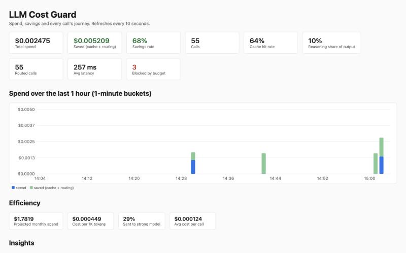
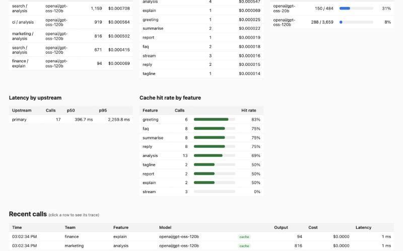
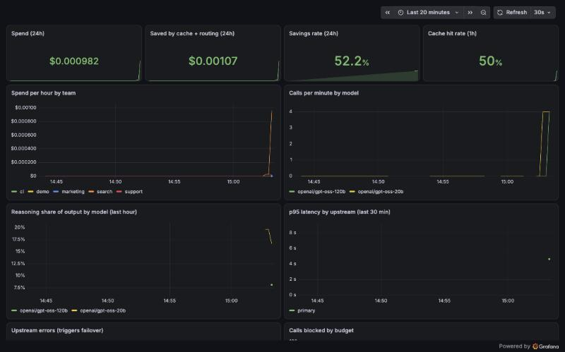
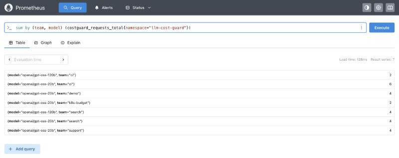
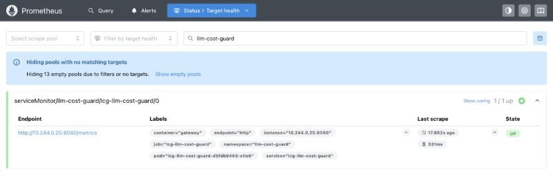
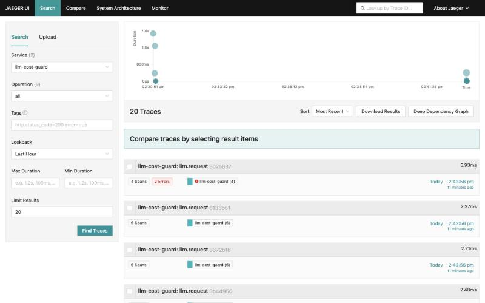
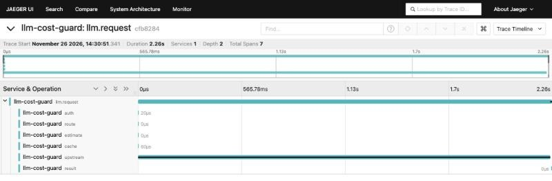

# Real-traffic test on a laptop

CI proves the chart installs and works against a simulated provider. This test proves it works the way a user runs it: **the published chart from GHCR, real calls to Groq, and the full monitoring stack**, on a MacBook Air (Apple Silicon) with Docker Desktop and kind.

```bash
./scripts/k8s-local-test.sh        # install and check (about 10 minutes the first time, 3 after)
./scripts/k8s-local-test.sh ui     # dashboards on localhost:8080, 3000, 9090 and 16686
./scripts/k8s-local-test.sh down   # delete the cluster
```

How the script works is in the [Kubernetes guide](Kubernetes.md#real-traffic-test-on-a-laptop).

## Result (v0.6.6, 26 November 2026)

All 23 checks passed.

| Area | Check | Result |
|---|---|---|
| Install | `helm test` (readiness and metrics, with the metrics token) | PASS |
| | Image pulled for arm64 | `llm-cost-guard-platform:0.6.6` |
| Real calls to Groq | Real answer | "Hello, how are you today?" |
| | Simple prompt routed to the cheap model | `openai/gpt-oss-20b` |
| | Repeat answered from the cache | hit |
| | Complex prompt routed to the strong model | `openai/gpt-oss-120b` |
| | Low reasoning effort on the cheap tier | applied; answer 63 output tokens |
| | Per-call trace recorded | 5 steps |
| | Streaming | 40 chunks, call priced |
| | Traffic from three teams (`demo`, `search`, `support`) | PASS |
| Cost controls | Budget exceeded | 429 before reaching the provider |
| | Totals | 26 calls, 16 cache hits, **$0.0011 spent, $0.0021 saved** |
| Operations | Data survives a pod restart | 26 calls before and after |
| | Logs | JSON lines |
| Monitoring | Prometheus scrapes the gateway via the ServiceMonitor | target UP, with bearer token |
| | `costguard_requests_total` in Prometheus | present |
| | Grafana dashboard loaded from the chart | PASS |
| | Traces in Jaeger | PASS |

A second run after slimming the monitoring stack (0.6.6 with the leaner kube-prometheus-stack) passed again: 12 of 12 top-level checks.

## Screenshots

Taken through `./scripts/k8s-local-test.sh ui` after the test runs plus 16 more real calls from five teams (search, support, marketing, finance, demo). At that point the gateway had handled **55 calls: $0.0025 spent, $0.0052 saved by caching and routing (68%)**.

**Gateway dashboard:** spend, savings, cache hit rate, routing and budget refusals.



**Gateway insights:** most expensive calls, cost per feature, latency by upstream, cache hit rate by feature and the recent calls (each row opens its trace).



**Grafana:** the dashboard shipped with the chart (`metrics.grafanaDashboard.enabled=true`), loaded by the Grafana sidecar, reading the ServiceMonitor-scraped metrics. Last 20 minutes.



**Prometheus:** calls by team and model, from the first run's 26 calls.



**Prometheus:** the gateway target, discovered through the chart's ServiceMonitor and scraped with the metrics token.



**Jaeger:** traces from the gateway. The trace with errors is the deliberate budget check (429).



**Jaeger:** one real call. Authentication, routing, the budget estimate and the cache lookup take microseconds; the 2.26 s is Groq.



## What the real runs found

Each run found something CI couldn't. All are fixed, and CI now covers the ones it can.

| Found | Why CI missed it | Fix |
|---|---|---|
| Pod never started on Apple Silicon: the image was amd64 only | CI runners are amd64 | 0.6.4: images for amd64 and arm64 (also AWS Graviton); both scanned |
| A rerun after a failed install also failed: Helm read the old Deployment's "progress deadline exceeded" | CI always starts from a new cluster | Script removes a failed earlier release first; the data volume is kept |
| `helm test` failed when `/metrics` is protected by `METRICS_TOKEN` | CI didn't set a metrics token | 0.6.6: `helm test` sends the token; CI now runs with one |
| Prometheus couldn't scrape: the token had a trailing newline from the file it was created from | CI never created the Secret from a file | 0.6.6: the gateway ignores surrounding whitespace in tokens; the script writes none |
| The smoke test expected exactly 4 calls in the database | CI always starts with an empty database | It counts only the calls it makes |
| Dashboard port-forwards dropped with "lost connection to pod" when Docker Desktop was nearly out of memory | Not part of CI | `ui` reconnects automatically; the monitoring stack only scrapes the gateway and itself |

Grafana's counters start again when the gateway pod restarts (the test restarts it on purpose), so the panels show traffic since the last restart; the gateway dashboard shows all history from the database.

## Sizing

Docker Desktop on the test machine had 3.75 GB of memory. The cluster plus Prometheus, Grafana and Jaeger used about 2.5 GB. With less than 4 GB, use `MONITORING=0` or raise the memory in Docker Desktop's settings.
